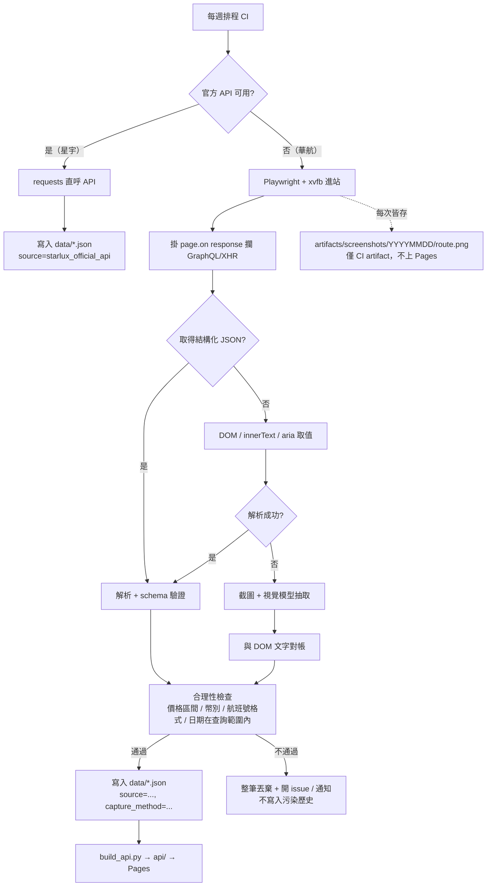

# 機票搜尋結果抓取方式評估：截圖 vs 文字/DOM vs API

> 研究日期：2026-10-31
> 範圍：華航（中華航空）桃園 TPE – 成田 NRT 為主，方法論適用全航線
> 性質：方法論評估（research only，未修改任何程式碼）

> **修訂記錄（2026-10-31，第二版）**
>
> 本版已把文末「附錄：反駁驗證」（經查證的最新結論）整合回主文，主文與附錄若有出入，**一律以附錄為準**。具體變更：
>
> 1. **修正實質錯誤**：§1 原「反爬破口」一詞已刪除。截圖不通過任何反爬閘門，它只是享用「真瀏覽器已過關」的結果；「破口」暗示截圖能繞過什麼，是錯的表述（詳見附錄-1.1）。
> 2. §3.1 比較表新增「對反爬的貢獻」維度（三方案貢獻皆為 0）。
> 3. §3.3 補上 airtrfx site token 說明（**依 urlscan 公開記錄推論，尚待實測驗證**）。
> 4. §4.1、§7 加入「先確認需求規模」條：需求規模先於技術方案。
> 5. 全文統一暴露面排序：`暴露面(攔截) ⊂ 暴露面(DOM) ⊂ 暴露面(截圖)`。
> 6. 成本結論改為一致表述：硬否決理由是**正確率與不可測試性，不是費用**（一年 $8–230，錢不是問題）。
>
> 附錄章節**保留不動**，其價值在於保留「曾被質疑、經驗證」的脈絡。

---

## 1. 結論摘要

**截圖不是更好的主要資料來源，也不是反爬手段。** 反爬閘門發生在 HTML 返回之前、像素出現之前 —— 過關靠的是真瀏覽器，與截圖無關；截圖不通過任何關卡，只是享用「瀏覽器已過關」的結果。它的常設價值只有兩項：**視覺存證**與**DOM/API 都失效時的 fallback**。

一句話版本：**能用 API 就用 API，不能用 API 就用 Playwright 抓 DOM 文字／攔截 XHR；只有在「資料只存在畫布上」、「DOM 完全被混淆到不可解析」或「需要人可覆核的視覺證據」時，才把截圖拉進來當輔助，且必須用 DOM/API 做數值對帳（cross-check），不可讓視覺模型單獨決定價格。**

對本專案的具體含意：

| 情境 | 建議 |
|------|------|
| 星宇（現況，官方 API 可用） | 維持 direct API，**完全不需要截圖** |
| 華航 `flights.china-airlines.com`（airtrfx 託管，Akamai 擋 curl/headless） | Playwright + xvfb 進站後，**優先攔截 GraphQL/XHR 回應**；DOM 文字次之；截圖只當 fallback 與存證 |
| 華航主站 `www.china-airlines.com`（403 Akamai） | 不建議硬闖；改走 OTA/聚合站或付費 API |
| 需要「證明某天看到多少錢」 | 截圖很有價值（歷史存證），但**不要公開散布**（見 §6） |

---

## 2. 專案現況與環境盤點

### 2.1 現有抓取程式：**有，而且是 pure API，不是瀏覽器**

實際執行：

```bash
find . -type f -not -path './.git/*' -not -path '*/node_modules/*' \
  -not -path '*/__pycache__/*' -not -path './api/trips/*' | sort
grep -rniE "playwright|puppeteer|selenium|scrap|crawl|screenshot|headless|chrome" \
  --include="*.py" --include="*.js" --include="*.yml" . --exclude-dir=node_modules --exclude-dir=.git
```

重點發現：

| 項目 | 現況 |
|------|------|
| `fetch_prices.py`（23 KB） | **星宇航空官方 API** 爬蟲：`requests.post` 打 `https://ecapi.starlux-airlines.com/searchFlight/v2/flights/search`，帶 UA 池、隨機延遲、重試 |
| 抓取方式 | **無瀏覽器、無 DOM 解析**；直接 JSON in / JSON out（`config.build_payload` → `query_flights` → 解析欄位） |
| 覆蓋範圍 | `config.py`：11 條航線（日本 6 + 其他 5）× `NUM_WEEKS = 40` → 每輪約 **440 次查詢** |
| 排程 | GitHub Actions `weekly-crawl-jp.yml` / `weekly-crawl-other.yml`，每週五 04:00 / 10:00 UTC，含 0–30 分鐘 jitter |
| 資料流 | `data/YYYYMMDD.json`（原始紀錄）→ `build_api.py` → `api/latest.json`、`api/trips/<route>/<dep>_<ret>.json` → GitHub Pages |
| 資料 schema | 扁平陣列，每筆含 `route_id / outbound_date / return_date / outbound_flight_no / price_total / currency / status / data_completeness / scraped_at / source` |
| `source` 欄位 | 現值 `"starlux_official_api"` → **schema 已預留來源標記，可容納混合式抓取**（見 §5） |
| `data_completeness` | `"Complete"`（已有欄位語意，可直接複用於「部分欄位靠截圖補」的情境） |
| 其他 Playwright 使用 | **只在 E2E 測試**（`tests/e2e_smoke.py`、`e2e_pwa.py`、`e2e_offline.py`），用途是驗前端，不是抓資料 |
| `fetch_ci_prices.py` | **不存在**（華航爬蟲只停在 tech-decision 階段，未實作） |

既有決策文件（重要前提，本次不推翻、只補方法層）：

- `docs/tech-decisions/華航票價爬蟲-2026-08-20.md`
  - `www.china-airlines.com` → **403 Akamai**
  - `curl` 403；Playwright headless **也 403**；**Playwright + xvfb → 200**
  - `flights.china-airlines.com` 是第三方 `airtrfx.com` 託管，資料來自 `vg-api.airtrfx.com/graphql`，直接呼叫回 `UNAUTHENTICATED`（此認證的性質見 §3.3：推論為頁面自帶的 site token，尚待實測）
  - 表單是 React，`fill()` 不會觸發 state（這是典型的「必須用真實事件 / `page.evaluate`」問題）
- `docs/tech-decisions/華航替代方案研究-2026-08-20.md`：Google Flights（`tfs` 參數 protobuf）、SerpAPI（100 次/月免費）、Amadeus（免費額度極小）、雄獅（JSONP）
- `docs/tech-decisions/Trip.com-API研究-2026-08-20.md`：有 `data-testid` 與可用的深連結 URL 格式，但航班搜尋 endpoint 未定位

**結論：本專案不是「要不要開始抓」的問題，而是「第二個來源（華航）用哪一層抓」。** 這個背景讓「截圖法」的比較非常明確：你已經有一條**零視覺成本**的成功管線，截圖若引入，是把成本從 API 轉移到 token 與不確定性。

### 2.2 環境可用性（實測）

```bash
for c in chromium google-chrome firefox node npm npx python3 pip3 xvfb-run Xvfb; do
  printf '%-22s ' "$c"; command -v "$c" || echo "(not found)"; done
node -v; npm -v; python3 -V
/usr/bin/chromium --version
pip3 show playwright | head -3
ls ~/.cache/ms-playwright
```

| 項目 | 結果 |
|------|------|
| `/usr/bin/chromium` | ✅ `Google Chrome for Testing 153.0.8010.12` |
| `google-chrome` / `google-chrome-stable` | ❌ 未安裝 |
| `firefox` | ❌ 未安裝 |
| `node` / `npm` / `npx` | ✅ v22.23.2 / 10.9.8 / 有 |
| `python3` / `pip3` | ✅ 3.13.5 / 有 |
| `xvfb-run` / `Xvfb` | ✅ 有（華航 xvfb 方案的先決條件成立） |
| Node Playwright | ✅ `node_modules/playwright` **1.63.0**（`package.json` 已有依賴，**不需 npm install**） |
| Python Playwright | ✅ `pip3 show playwright` → **1.62.0**（E2E 在用） |
| Playwright 瀏覽器快取 | ✅ `~/.cache/ms-playwright/chromium-1243`、`chromium_headless_shell-1243`、`ffmpeg-1011` |

實測 headless 可跑、可截圖、可讀 DOM（用現有 node_modules，未安裝任何東西）：

```js
// /tmp/pw_probe.mjs
import { chromium } from '.../node_modules/playwright/index.mjs';
const b = await chromium.launch({ headless: true });
const p = await b.newPage();
await p.setContent('<h1 id=t>TPE-NRT NT$ 12,345</h1>');
const shot = await p.screenshot({ type: 'png' });
console.log(await p.innerText('#t'), shot.length);
```

輸出：

```json
{"ok":true,"chromiumVersion":"153.0.8010.12","screenshotBytes":9458,"innerText":"TPE-NRT NT$ 12,345"}
```

**環境判讀：**

1. 三種方法在本機**都做得到**，環境不是選擇依據。
2. 真正的限制在 **CI**：目前兩個 crawl workflow 只 `pip install -r requirements.txt`（`requests`, `lunardate`），**沒有 Node、沒有 Playwright、沒有 xvfb**。任何瀏覽器方案都要新增 CI 步驟（`npx playwright install --with-deps chromium` 或 `sudo apt-get install -y xvfb`），單次 job 時間與失敗率都會上升。
3. 一頁 1280×900 的截圖 PNG 約 **100 KB–1 MB**（純文字頁 ~9.5 KB；航班列表頁有圖示/logo，實務上數百 KB）。

---

## 3. 三方案比較

定義：

- **A｜截圖**：headless browser `page.screenshot()`（可能搭配 `--full-page` 或分頁滾動），把圖丢給多模態模型或 OCR 取欄位。
- **B｜文字/DOM**：同樣用瀏覽器渲染完成後，`innerText` / `textContent` / accessibility tree / 選擇器定位取值；或用 `requests + BeautifulSoup`（僅適用非 SPA）。
- **C｜API / 網路攔截**：直接呼叫 endpoint，或用 Playwright `page.route()` / `page.on('response')` 攔截 XHR/GraphQL，取得**原始 JSON**。

### 3.1 比較表

| 維度 | A. 截圖 | B. 文字 / DOM | C. API / 攔截 |
|---|---|---|---|
| **資料結構化程度** | ❌ 最差。像素 → 文字 → 再推論欄位綁定（哪個價格屬於哪個班號） | 🟡 中。文字線性，但航班卡片是巢狀結構，`innerText` 會把「票價 / 艙等 / 行李 / 稅金」混在同一段，需靠鄰近性或選擇器重建 | ✅ 最佳。原生欄位名、巢狀結構、貨幣/稅金分開 |
| **穩定性（改版/A-B test/反爬）** | 🟡 版面改了模型常常「還能讀出東西」但**欄位對錯位**（靜默錯誤，最危險） | 🔴 選擇器一改就爆；但爆得**明顯**（抓不到 → 測試失敗） | 🟡 欄位名改動就爆，但同樣爆得明顯；端點被加簽章時需重抓 token |
| **可驗證性 / 可除錯** | ❌ 差。無法斷言「價格欄位＝這個數字」；除錯只能人眼看圖；**迴歸測試幾乎不可能寫** | ✅ 好。可寫 selector 斷言、可存 HTML snapshot、可 diff | ✅ 最好。可存 JSON fixture、可寫 schema 驗證、可對帳 |
| **成本（token / 儲存 / 頻寬）** | ❌ 最貴。每張圖 ~1–2k tokens（1280×900 依模型約 1.1M px；Claude 類 `w*h/750` ≈ 1.5k，OpenAI 類 512px tile ≈ 1.7k）。40 週 × 11 航線 ≈ 440 次搜尋，每次 1–3 張 → **每輪 0.5–1.3M tokens**；加上數百 MB 截圖儲存 | ✅ 低。一頁 HTML/text 數十 KB | ✅ 最低。一個 JSON 回應 5–50 KB |
| **速度** | ❌ 慢。頁面渲染 + 截圖 + 視覺模型推論（每次 2–10 秒）→ 440 次 = 15–70 分鐘推論時間，且撞 rate limit | 🟡 中。仍需完整渲染與等待 | ✅ 快。API 直呼（現況星宇 440 次查詢可在 GitHub Actions 一次 job 內完成） |
| **準確率風險（誤讀數字）** | 🔴 高。`15,876` vs `15,876`、`6/8`、`0/8`、`1,5` 千分位、`NT$` 與 `TWD`、促銷價與原價、來回總價 vs 單程、含稅 vs 未稅 — 全是視覺模型的經典失敗模式；而且**錯的時候通常很有自信** | 🟢 低。數字是原始字元 | 🟢 最低。數字本身就是數值型別（`price_total` 已是 int） |
| **對 SPA 動態渲染的適應力** | ✅ 好（只要畫面出來就能拍） | ✅ 好（`wait_for_selector` 後取值） | 🟡 中。需要知道何時攔、攔哪個 request；但**渲染完成與 API 回應幾乎同時**，通常比等畫面更早拿到資料 |
| **法律 / ToS 風險** | 🔴 最高。截圖＝重製他人網頁內容，**公開散布**（本專案 `api/` 會上 GitHub Pages）風險明顯高於存 JSON | 🟡 中。與 C 相近，但大量抓取仍受 ToS / robots 約束 | 🟢 較低（仍受 ToS 約束，尤其是繞過認證/簽章時） |
| **視覺佐證 / 存證價值** | ✅ **唯一強項**。能證明「當下畫面確實這樣顯示」，適合客服爭議、價格錯誤回報 | ❌ 無 | ❌ 無 |
| **對 canvas / WebGL / 混淆 DOM** | ✅ 唯一可行 | ❌ 不可行 | 🟡 若資料來自 API 仍可行（通常如此） |
| **CI 複雜度** | 🔴 需瀏覽器 + xvfb + 視覺模型 API key + 截圖 artifact 儲存 | 🟡 需瀏覽器（+ xvfb） | 🟢 純 HTTP（若 endpoint 可直接打）／🟡 需瀏覽器（若需攔截） |
| **對反爬的貢獻** | **0**（反爬發生在過關之後；且滾動／多次截圖使暴露面**略增**） | **0**（零額外請求；滾動會產生少量行為訊號） | **0**（被動監聽，零額外請求，暴露面最小） |
| **真正影響反爬的是** | 三者**共用同一個前提**：先用真瀏覽器過關（本專案實測：`curl` 403 / Playwright headless 403 / **Playwright + xvfb 200**）。這個變因是「用不用真瀏覽器」，不是「資料怎麼取出」 | 同左 | 同左 |

> 對反爬的貢獻：三方案**相同（都是 0）**，差別只在暴露面大小 —— 全文統一為
> `暴露面(攔截) ⊂ 暴露面(DOM) ⊂ 暴露面(截圖)`。
> 也就是說，在「避免被反爬盯上」這個目標上，截圖不但沒有優勢，是三者中最差的一個。

### 3.2 關鍵非對稱性（本評估最重要的一點）

**A 的失敗是靜默的，B/C 的失敗是響亮的。**

- 選擇器壞掉 → `TimeoutError` → CI 紅燈 → 你當天就知道。
- API 欄位改名 → `KeyError` → CI 紅燈。
- 截圖法遇到改版 → 模型**還是會吐出一個看起來合理的 JSON**，價格可能來自上一個航班的卡片、或把「最低價提示」當成票價。你可能連續數週把錯誤價格寫進 `data/*.json`，而這份錯誤資料會被 `build_api.py` 當成歷史趨勢，最後觸發「價格下降」推播。

對一個**每週自動 commit 資料、且會推播通知**的專案，靜默錯誤的代價遠高於其他所有維度。這一點單獨就足以否決「截圖作為主要資料來源」。

### 3.3 針對華航的具體套用

| 階段 | 做法 | 何者勝出 |
|---|---|---|
| 進站（繞 Akamai） | Playwright + xvfb（headless 會 403） | B/C 共用（都要真瀏覽器） |
| 取得航班清單 | `page.on('response')` 攔 `vg-api.airtrfx.com/graphql` 的 POST/回應 | **C**（原始 JSON，含 `totalPrice` 等欄位） |
| 若 GraphQL 回應被壓縮/混淆 | `page.innerText()` + 針對航班卡片的 `data-*` / `aria-label` 取值 | **B** |
| 若結果區是 canvas 或 DOM 完全 hash 化 | `page.screenshot()` + 視覺模型 | **A（唯一選項）** |
| 每次成功抓取 | **額外**存一張截圖到 `artifacts/`（不進 `api/`、不公開） | **A（存證）** |

**關於「進站（繞 Akamai）」這一列的兩個必要補充：**

1. **A / B / C 三者都要真瀏覽器過關**，截圖沒有降低這一步的成本（見附錄-1.1、附錄-2.4）。暴露面排序全文統一為 `暴露面(攔截) ⊂ 暴露面(DOM) ⊂ 暴露面(截圖)`。
2. **GraphQL 的「需認證」不等於「需登入」**：經查 `vg-api.airtrfx.com` 的 CORS `access-control-allow-headers` 明確允許 `authorization`，且該 GraphQL 請求是由航空公司站**自己的 Next.js chunk**（`_next/static/chunks/*.js`）發起，不是使用者登入後才有的。因此 `authorization` 屬 **site token（站台公開發給頁面的 token）而非登入態**，瀏覽器進入頁面即自然持有 → **攔截時天然取得，不需破解簽章、不需理解 query 長相**。
   ⚠️ **此項依 urlscan.io 對多個 airtrfx 客戶站（如 flyporter / alaskaair）的公開記錄推論，尚待實測驗證**（token 存放位置與 TTL 未確認）。請勿當成已證實的事實使用；但即使最終證實需要額外處理，結論方向不變 —— 那也是「讓瀏覽器自己帶」，而不是「改用截圖」。

---

## 4. 截圖法的適用 / 不適用情境

### 4.1 截圖真的更好的情境（可接受為主要手段）

**先界定適用範圍**：以下第 1–3 點是「截圖唯一可行」，第 4–6 點是「截圖成本較低」，而**第 4–6 點的成立前提是規模很小（< ~20 次查詢）**；一旦進入 440 次/輪的排程，第 4–6 點全部不成立。

**需求規模先於技術方案**：若目的只是一次性確認某幾天的班次與價格（1–8 次查詢），正解是「**人工查 + 截圖存證**（15–30 分鐘完成）」，而不是任何一種爬蟲 —— 包括本文推薦的攔截路線。詳見 §7 第 6 點與附錄-4.3。

1. **資料只存在 canvas / WebGL 畫布**：文字層不存在，DOM 只有 `<canvas>`。此時 OCR/視覺是唯一路徑（例如部分票價日曆、地圖式介面）。
2. **DOM 被徹底混淆且結構每次 render 都變**（class 全 hash、無 `data-testid`、無 aria），選擇器維護成本高於視覺推論成本。
3. **需要「視覺佐證」的存證需求**：價格錯誤申訴、客服爭議、記錄「官網當時顯示的促銷 banner 與票價」。
4. **反爬只看「是否有真實渲染 + 人類可視互動」**：某些站點要求真實繪製（xvfb 非 headless）才放行；此時你**已經**有截圖能力，順手存證成本近乎零。
5. **一次性、低頻的人工輔助驗證**：例如 quarterly 抽查 5 個航線，用截圖快速核對 API 數字是否與官網一致（人類看圖，不是模型看圖）。
6. **極短期 POC**：想 30 分鐘內確認「這個網站到底有沒有我要的資料」，截圖比寫 parser 快。**但 POC 完就該換掉。**

### 4.2 強烈不建議把截圖當主要資料來源的情境

1. **要建立時間序列 / 趨勢圖 / 觸發降價通知**（本專案核心用途）。→ 440 筆/週的數值準確度無法容忍視覺誤讀。
2. **有現成 API 或可攔截的 XHR**（星宇現況、華航 airtrfx GraphQL）。→ 放著結構化 JSON 不用，等於自願把成本乘 10、準確度除以 10。
3. **需要 CI 迴歸測試**。→ 截圖無法 assert，只能人眼 diff；snapshot 比較會被動態價格/廣告 banner 弄爆。
4. **成本敏感 / 規模化**（>50 次查詢/輪）。→ token 成本與 rate limit 會成為主要瓶頸。
5. **產出要公開散布**（本專案 `api/` 部署到 GitHub Pages）。→ 公開轉載航空公司頁面截圖，法律風險高於公開票價數值。
6. **數字位數多、有千分位、有多個價格並列**（票價、稅金、行李費、促銷原價/特價）。→ 視覺模型最容易在此出錯，而錯誤不易被發現。

---

## 5. 推薦架構：API 優先、DOM 次之、截圖為存證與 fallback

### 5.1 分層原則

```
第 0 層：官方 / 公開 API（成本最低、最穩）        ← 星宇現況
第 1 層：瀏覽器渲染後「攔截 XHR / GraphQL」        ← 華航首選
第 2 層：瀏覽器渲染後「DOM / accessibility tree」  ← 第 1 層拿不到時的替代
第 3 層：截圖 + 視覺模型（僅 fallback，且必須對帳） ← 最後手段
橫切面：每次抓取都存一張截圖作為 evidence（不進公開 API）
```

**鐵則：任何價格寫入 `data/*.json` 前，必須有「至少兩個獨立來源」或「一個結構化來源 + 合理性檢查」同意。** 視覺模型永遠不該是唯一證人。

### 5.2 流程



### 5.3 落地要點（對應本專案現有結構）

1. **`source` 欄位擴充**：現有 `source` 已是自由字串，直接新增值：
   - `starlux_official_api`（現況，不動）
   - `ci_airtrfx_graphql`（華航攔截）
   - `ci_dom`（華航 DOM）
   - `ci_vision_fallback`（截圖 fallback，**應極少出現；若常出現即代表架構退化**）

   建議再加 `capture_method` 與 `evidence_ref`（截圖路徑/雜湊），讓 `build_api.py` 可以統計各來源占比。

2. **不要動 `build_api.py` 的 dedupe 邏輯**：它目前以 `(route_id, outbound_date, return_date, outbound_flight_no)` + 最大 `scraped_at` 取最新。混合來源只要 schema 一致就能共存，這是本專案既有的優勢。

3. **對帳（cross-check）**：若同一輪同時拿到 DOM 文字與截圖視覺結果，比對 `price_total`：
   - 相同 → 採用結構化值，截圖僅存證。
   - 不同 → **不寫入**，記錄 `confidence=low` 並開 issue。這一步是防止靜默錯誤的最後防線。

4. **CI 調整**（華航專用 workflow，不影響現有星宇 workflow）：
   ```yaml
   - run: sudo apt-get update && sudo apt-get install -y xvfb
   - run: npx playwright install --with-deps chromium   # 或沿用 python -m playwright install
   - run: xvfb-run --auto-servernum python fetch_ci_prices.py
   - uses: actions/upload-artifact@v4                   # 截圖存證，7–30 天後自動清除
     with: { name: ci-screenshots, path: artifacts/screenshots, retention-days: 14 }
   ```
   注意：截圖 **不要** commit 進 repo，也不要放進 `_site/`（`deploy.yml` 目前是 `cp -r api _site/` + 複製 `web/`，只要不放到這兩個目錄就不會被公開）。

5. **失敗策略**：寧可當週缺資料，也不要寫入可疑價格。現有 `NO_FLIGHT_ERROR_CODES`（星宇 `01003`）已示範「空結果 ≠ 失敗」的處理；華航請沿用同樣精神：空結果要能與「解析失敗」區分。

6. **POC 建議（半天內可完成，且不改主流程）**：
   - 目標：華航 TPE–NRT 單一航線、單一日期，證明能從 `vg-api.airtrfx.com/graphql` 攔到含價格的 JSON。
   - 驗收條件：(a) 取得 ≥1 筆航班與 `price_total`；(b) 與頁面文字顯示的價格一致；(c) 連續跑 3 次結果穩定；(d) 全程不呼叫視覺模型。
   - **若 (a) 失敗才進入 DOM 層；只有 DOM 也失敗才考慮截圖。** 這個順序本身就是本次評估的結論。

---

## 6. 風險與注意事項

### 6.1 方法論風險

| 風險 | 說明 | 緩解 |
|------|------|------|
| **靜默錯誤**（最高） | 視覺模型改版/錯位仍輸出合理 JSON，污染歷史與推播 | 雙來源對帳；合理性檢查；`ci_vision_fallback` 比例告警 |
| **模型版本漂移** | 同圖片換模型/換版本 → 抽取結果不同，歷史資料不可重現 | 若一定要用，固定模型版本並把「解析結果 + 模型版本」一併記錄；不要讓它成為趨勢資料來源 |
| **數字誤讀** | 千分位、0/8、6/8、促銷原價 vs 特價、單程 vs 來回、含稅 vs 未稅 | 只取整數 + 幣別；與 DOM 對帳；票價區間 sanity check |
| **截圖不完整** | 結果列表需滾動分頁，`full_page` 可能漏載 lazy-load 卡片 | 明確定義「一頁一查詢」，必要時逐卡片 element screenshot |
| **成本失控** | 每週 440 查詢 × 多張圖 | 僅在 fallback 觸發；設每輪 token/圖片上限並記錄 |
| **CI 時間** | 瀏覽器 + xvfb + 視覺推論會讓 job 從分鐘級變小時級 | 華航獨立 workflow；限制航線數；必要時分矩陣 |
| **測試不可寫** | 截圖路徑無法做 assertion | 把「解析」與「擷取」分離：擷取層輸出圖片/HTML fixture，解析層用固定 fixture 寫單元測試 |

### 6.2 法律 / 倫理 / 營運風險

1. **ToS 與 robots.txt**：本專案是個人研究用途，但 `api/` 公開發布 + 每週自動抓取，已接近「持續性資料收集」。建議：維持低頻（每週 1 次）、禮貌延遲（現有 2–6 秒隨機延遲可沿用）、不繞過登入或付費牆。
2. **截圖的散布風險**：截圖包含航空公司 logo、版面設計、促銷文案。**只做內部存證、不進 `_site/`**，可大幅降低爭議。若要對外展示，改用「你自己重繪的表格」。
3. **繞過反爬的界線**：`headless` → `xvfb` 是為了讓頁面正常渲染（合理），但**偽造 UA、繞過驗證碼、破解簽章**屬於不同等級。Akamai 403 建議視為「此站不歡迎自動化」，優先改用有授權的 API（Amadeus / SerpAPI / Duffel）或已公開的 OTA 深連結。
4. **資料正確性的對使用者責任**：本專案會推播「降價」通知。一筆誤讀的價格就可能造成錯誤告警。這點在架構上比「抓不抓得到」更重要。
5. **不要用截圖取代可測試性**：本專案已有相當完整的單元/E2E 測試文化（`tests/unit/*`、`tests/e2e_*.py`）。引入不可斷言的資料路徑，會是這個專案品質模型裡唯一的破口。

---

## 7. 最終建議（決策版）

1. **星宇**：維持現況（direct API）。**不要**為了「一致性」把星宇也改成截圖。
2. **華航**：實作順序固定為 **攔截 GraphQL → DOM 文字 → 截圖 fallback**。先用半天 POC 驗證第 1 層；第 1 層成功就不需要往下走。
3. **截圖的唯一常設用途**：`artifacts/` 存證（CI artifact，14 天，不公開、不 commit），以及人工抽查時的眼睛輔助。
4. **不要**把截圖產出的價格直接餵進 `data/*.json` 的趨勢資料；若真的必須，標記 `capture_method=ci_vision_fallback` 並與結構化來源對帳，不符就丟棄。
5. **成本結論（已依附錄-3 校正）**：對 440 次/輪的規模，截圖法會把抓取成本從「幾乎為零」推到「每輪 1.3–1.5M tokens + 264 MB 儲存 + 1.4–2.7× CI 時間」。
   但**費用本身不是否決理由**：一年 $8–230（附錄-3.2），對個人專案完全可負擔；若爭論點只在「錢」，截圖路線其實站得住。
   **硬否決理由是「正確率」與「不可測試性」**：樂觀假設 0.5% 欄位錯誤率 → 每輪約 44 個錯誤欄位被靜默寫入 `data/*.json`，再被 `build_api.py` 當成歷史趨勢、由 `detect_drops()` 觸發錯誤的降價推播；而截圖路徑**無法寫迴歸測試**。錯誤形態是「靜默且自信」，這才是不能接受的地方。
6. **先確認需求規模（需求規模先於技術方案）**：若當前需求只是「TPE–NRT 週六去／隔週日回有哪些班、大概多少錢」（1–8 次查詢），正確做法是**人工查 + 截圖存證（15–30 分鐘內）**，把值得長期追蹤的範圍寫進 `config.py`；等確認需要「40 週 × 11 航線自動追蹤」後，再啟動 `xvfb + 攔截 GraphQL` 的管線。**不要在需求還是一次性研究時，先付自動化 + CI 的固定成本**，而且啟動自動化時走的也是攔截路線，不是截圖讀圖（見附錄-4.3）。

---

## 附錄 A：本次盤點實際執行指令

```bash
# 專案結構
find . -type f -not -path './.git/*' -not -path '*/node_modules/*' \
  -not -path '*/__pycache__/*' -not -path './api/trips/*' | sort

# 抓取相關關鍵字
grep -rniE "playwright|puppeteer|selenium|scrap|crawl|screenshot|headless|chrome" \
  --include="*.py" --include="*.js" --include="*.yml" . --exclude-dir=node_modules --exclude-dir=.git

# 環境
for c in chromium chromium-browser google-chrome firefox node npm npx python3 pip3 xvfb-run Xvfb; do
  printf '%-22s ' "$c"; command -v "$c" || echo "(not found)"; done
node -v; npm -v; python3 -V; /usr/bin/chromium --version; pip3 show playwright

# 依賴
cat package.json; cat requirements.txt; ls node_modules; ls ~/.cache/ms-playwright

# 實測 headless（未安裝任何套件）
node /tmp/pw_probe.mjs
```

## 附錄 B：與其他研究文件的關係

- 本文件只處理「**用哪一層擷取**」的方法論，不重複 `docs/tech-decisions/華航票價爬蟲-2026-08-20.md` 已完成的網站可行性調查。
- 華航 TPE–NRT 班表/票價的資料面研究屬另一份文件，本文件不涉及。
- 若後續採用攔截 GraphQL 路線，建議新增 `docs/tech-decisions/華航票價爬蟲-攔截層-YYYY-MM-DD.md` 記錄 endpoint 與 schema，而非改動本文件。

---

## 附錄：反駁驗證 —— 「直接截圖就能少突破反爬」這個想法成立嗎？

> 追加日期：2026-10-31（同批研究，回應使用者對 §1 結論的反駁）
> 使用者原文：「不適合嗎？我主要想說 都會防機器人，如果直接截圖，就可以少突破很多東西」
> 撰寫立場：不預設既有結論正確。使用者的直覺裡有一個**正確的核心**與一個**錯誤的歸因**，兩者必須分開講。

### 附錄-1. 核心事實釐清：反爬閘門發生在「像素存在之前」

#### 1.1 反爬檢查的時間軸

一個受 Akamai / Cloudflare 保護的頁面，請求生命週期是這樣：

| 階段 | 檢查項目 | 發生在取得 HTML 之前/之後 | 截圖能幫上忙嗎 |
|---|---|---|---|
| ① TCP / TLS 握手 | JA3 / JA4 指紋、TLS 版本與 cipher 順序 | **之前** | ❌ 完全無關（此時瀏覽器還沒開始渲染） |
| ② HTTP 層 | HTTP/2 指紋、header 順序與大小寫、UA/Client-Hints 一致性 | **之前** | ❌ 完全無關 |
| ③ 第一次 HTML 回應 | 發放 `_abck` / `bm_sz` / `cf_clearance` cookie，可能直接回 403 或 challenge 頁 | **之前（就是你拿到的那個 403）** | ❌ 你在這一步就失敗了，根本沒有畫面可拍 |
| ④ 瀏覽器執行 sensor / challenge JS | `sensor_data` 上報、proof-of-work、canvas/webgl 指紋、`navigator.webdriver` 等 | **之後（頁面已開始載入）** | 🟡 這一步**需要真瀏覽器**才過得了；但過關靠的是「瀏覽器在跑 JS」，不是「有沒有截圖」 |
| ⑤ 通過後的資料請求 | XHR / GraphQL（可能帶 `authorization`） | 之後 | 🟡 同上，靠的是瀏覽器身分與 session，不是截圖 |
| ⑥ 頁面渲染出票價 | DOM / canvas 上出現 `NT$ 15,876` | 最後 | ✅ **這是截圖唯一的位置** —— 也就是「所有關卡都已經過了之後」 |

**關鍵結論：截圖是整個管線最末端、最下游的一個動作。它不通過任何閘門，它只是享用別人已經通過的結果。**

換句話說：截圖路線的反爬工作量 **不少於** 真瀏覽器路線，而是**等於**（實際上略多，見 1.3）。如果你已經在跑真瀏覽器，閘門已經過了 100%；此時改不改用截圖，對「要突破多少東西」的答案是**零差異**。

#### 1.2 使用者的直覺被拆成兩個獨立決策

使用者的句子裡其實混了兩件事：

| 決策 | 選項 | 對「反爬難度」的影響 | 對「資料取得成本」的影響 |
|---|---|---|---|
| **決策一：用什麼客戶端** | 真瀏覽器（Playwright + xvfb） vs 純 HTTP client（curl / requests） | **決定性**。這是 403 與 200 的分界線 | 中（瀏覽器較慢、CI 較重） |
| **決策二：資料怎麼取出** | 截圖讀圖 vs `innerText`/DOM vs 攔截 XHR/GraphQL | **幾乎為零** | **巨大**。這才是成本差異所在 |

使用者說「截圖可以少突破很多東西」，實際發生的效益全部來自**決策一**。而使用者在談決策一時，心中想的替代方案（逆向 API、偽造 header/signature、解 JS challenge）確實是很貴的 —— 這一點他是對的。但他的結論下在決策二上，這是把決策一的效益記到決策二的帳上。

證據就在本文件自己引用的實測結果裡：`curl` → 403、Playwright headless → 403、**Playwright + xvfb → 200**。這組對照從頭到尾沒有出現「截圖」這個變因。200 是 xvfb 給的，不是 screenshot 給的。

#### 1.3 一個容易漏掉的反向事實：截圖其實比 DOM/攔截「多」一點成本

決策二的三個選項，在已經有真瀏覽器 session 的前提下：

- **攔截**：`page.on('response')` 是被動監聽，**零額外請求、零額外互動**。反爬暴露面 = 純瀏覽器瀏覽的暴露面。
- **DOM**：零額外請求，但需要在頁面上多等一下渲染、可能需要滾動（滾動會產生行為訊號）。
- **截圖**：零額外請求，但需要 `full_page` 或逐卡片截圖，通常要**滾動 lazy-load**（多產生行為/滑鼠事件軌跡）。若整頁高度大，還可能觸發額外的圖片/字型載入請求。

也就是說 `暴露面(攔截) ⊂ 暴露面(DOM) ⊂ 暴露面(截圖)`（全文統一的寫法）。**截圖在這條軸上不但沒有優勢，是最差的一個。** 這是本次驗證中對使用者最直接的反駁，而且是與既有結論方向一致、但理由更精確的一點。

#### 1.4 那使用者到底哪裡對？—— 兩個他真的成立的地方

必須明確說：使用者的直覺不是錯的直覺，只是錯的標籤。

1. **「都會防機器人」→ 這個前提 100% 正確，而且它確實翻轉了方案排序。**
   如果一個站有 Akamai，那麼「純 HTTP client + 造 header」這條路基本上可以整條劃掉，真瀏覽器從「可選」變成「唯一」。使用者對這點的判斷比「先試 API」的直覺更貼近現實。本文件 §5.1 的分層圖在這一點上是**支持他的**（第 1、2 層都以「瀏覽器渲染後」為前提）。

2. **「不想逆向 API / signature / JS challenge」→ 這個成本規避的動機完全正當。**
   而且實務上最省力的做法不是截圖，是 **在瀏覽器內發 fetch / 攔截**：
   - 不需要知道 GraphQL schema 就能拿到回應（先攔下來看）。
   - 不需要自己實作簽章 —— 簽章留在頁面 JS 裡跑（`page.evaluate()` 在頁面 context 內執行，繼承頁面的 token、cookie、TLS session）。
   - 不需要偽造 header —— 瀏覽器自己就會帶對。
   這就是「少突破很多東西」的正確實作，只是取出的不是像素，而是 JSON。

**一句話總結 1.4：使用者想省的那些工，真的可以省；但省下它的方法是「讓瀏覽器自己做事」，不是「把畫面拍成圖」。**

---

### 附錄-2. 本專案證據檢驗：華航這個案例裡，過了關之後最省力的是什麼？

#### 2.1 `fetch_prices.py`（星宇現況）證明「反爬成本」與「取資料方式」無關

實際程式碼事實（`fetch_prices.py` + `config.py`）：

| 項目 | 實況 |
|---|---|
| 呼叫方式 | `requests.post(config.API_URL, json=payload, headers=...)`，`API_URL = https://ecapi.starlux-airlines.com/searchFlight/v2/flights/search` |
| 認證 | **完全沒有**。沒有 token、沒有簽章、沒有 HMAC、沒有時間戳 |
| Header | 靜態 5 個：`Content-Type` / `jx-lang` / `Accept` / `Referer` / `Origin`，外加 `random.choice(config.USER_AGENTS)` |
| 反爬對策 | UA 池輪替 + `REQUEST_DELAY_MIN/MAX = 2.0/6.0` 秒隨機延遲 + `RETRIES = 3` |
| 資料取出 | `body["data"]` → `parse_flights()` 直接吃 JSON 欄位，`price_total` 已是 int |
| 錯誤處理 | `NO_FLIGHT_ERROR_CODES = {"01003"}` 區分「該週無航班」與「抓取失敗」 |

**這條管線的存在本身就是論證**：星宇的 portal 也有機器人意識（要 UA、要 Referer/Origin、要節奏），但沒有到 Akamai 等級，所以「決策一」根本不用升級到瀏覽器，440 次查詢零 token 成本、零瀏覽器、零 CI 額外步驟就完成了。反過來說：**如果哪天星宇也升到 Akamai，唯一要做的事就是把 `requests.post` 換成 `page.evaluate(fetch)`，`parse_flights()` 一行都不用改。** 這正是「決策一會變、決策二不變」的最佳實證。

#### 2.2 華航：技術決策文件的三個關鍵事實，如何決定最省力的取出方式

來自 `docs/tech-decisions/華航票價爬蟲-2026-08-20.md`：

| 事實 | 對「取出方式」的意涵 |
|---|---|
| `www.china-airlines.com` → 403 Akamai | 決策一：必須真瀏覽器（且 xvfb） |
| `curl` 403 / Playwright headless 403 / **xvfb 200** | 決策一的成本是「有沒有真實繪製」，與截圖無關 |
| `flights.china-airlines.com` = `airtrfx.com` 託管，資料來自 `vg-api.airtrfx.com/graphql` | 資料的**源頭是 JSON**，畫面只是它的投影 |
| 直接呼叫 GraphQL → `UNAUTHENTICATED` | 需要認證，但關鍵是：**瀏覽器自己是怎麼拿到的？** |
| React 表單 `fill()` 無效（值沒進 state） | ⚠️ 這才是真正難、真正貴的一步 —— 而且**三種取出方式都要付這個成本** |

#### 2.3 關鍵追問：GraphQL 的認證是「登入態」還是「頁面 JS 現算」？

這一點決定攔截能不能重用，所以我去查證了：

- `vg-api.airtrfx.com/graphql` 是 **Apollo Server**，回應 CORS 的 `access-control-allow-headers` 明確列出 **`authorization`**、`csrfp_token`（來源：urlscan.io 對多個 airtrfx 客戶站如 flyporter / alaskaair 的請求記錄）。
- 該 GraphQL 請求是由**航空公司網站自己的 Next.js chunk** 發起的（`_next/static/chunks/*.js` → `POST /graphql`），不是使用者在瀏覽器裡登入後才有的。

**推論（查證後的判斷）：**

`authorization` 不是「使用者登入態」，而是 **airtrfx 發給該 airline 站台的 public/site token**，由頁面 JS 持有並在每次 GraphQL 請求帶上（可能存於 `localStorage` / 頁面 config / 另一個 bootstrap 端點，且可能有 TTL）。

這對本題有三個直接後果：

1. **「需要認證」≠「必須登入」**。所以技術決策文件裡「GraphQL 需認證」這條，實務上被解讀成「不能裸 curl」是正確的，但被解讀成「所以只能靠截圖」是錯的。
2. **攔截幾乎零成本、且必然可用**：頁面 JS 自己會帶上正確的 `authorization`，`page.on('response')` 直接拿到含 `totalPrice` 的 JSON。你不需要理解簽章，甚至不需要先知道 query 長什麼樣 —— 這是「少突破很多東西」的**最省力版本**。
3. **重用策略分兩級，兩級都不需要視覺**：
   - 首選：**在頁面 context 內打**。`page.evaluate()` 裡用 `fetch('/graphql', ...)`，token、cookie、TLS、session 全部是瀏覽器自己的 → 沒有「重放被拒」的問題。
   - 次選：把攔到的 `authorization` 取出來，在**同一個 browser context 內**重用（注意 TTL，過期就重新導航一次拿新的）。**不建議**搬到瀏覽器外長期重用（會同時踩 token TTL 與 JA3/session 綁定兩顆雷）。

#### 2.4 所以華航過了 xvfb 之後，最好的取出方式是什麼？

| 取出方式 | 額外工作量 | 資料品質 | 額外 CI 成本 | 判定 |
|---|---|---|---|---|
| **攔截 GraphQL response** | 掛一個 listener；寫一個 JSON → schema 的 mapping | 原始 JSON，`totalPrice` 是數值 | 0 | ✅ **最佳** |
| DOM `innerText` / aria | 選擇器 + 巢狀結構重建（票價/艙等/行李/稅金混在一段文字） | 字串，需 regex | 0 | 🟡 次之（改版會爆，但爆得響） |
| 截圖 + 視覺模型 | **額外一整套**：截圖策略、lazy-load 滾動、視覺 API key、token 預算、對帳邏輯、無法寫 regression test | 像素 → 推論，**欄位綁定與數字都可能出錯且不會報錯** | 視覺 API 費用 + job 時間 + artifact 儲存 | ❌ 最差 |

**核心不對稱性（本附錄最重要的一句）：在華航這個案例，`GraphQL 的 JSON 本來就會自己飛過網路`。截圖等於是把已經到手的結構化資料丟掉，改去解析它的截圖。**

這不是「兩種權衡」，這是**資訊丟失後再花錢重建**。原始 JSON 有 `totalPrice`、`currency`、`flightNumber`、`departureDateTime` 等具名欄位；截圖只留下它們的像素投影，而且把「哪個價格屬於哪個班號」這個最重要的綁定關係，從資料結構降級成視覺推論問題。

#### 2.5 順帶修正既有文件的一處內在張力

本文件 §1 與 §3.3 建議「華航優先攔截 GraphQL」，但技術決策文件說「GraphQL 需認證（`UNAUTHENTICATED`）」。兩者放在一起讀，會讓人以為攔截路線有未解的認證障礙 —— 這正是使用者會轉向截圖的原因之一。**§2.3 的追問回答了它：認證是頁面 JS 自帶的 site token，攔截天然取得，不需要另外破解。** 建議在 §3.3 補上這一句（見附錄-5）——**第二版已套用**。

---

### 附錄-3. 成本量化對比（本專案實際規模）

規模前提：**11 航線 × 40 週 = 440 次查詢/輪**，GitHub Actions 每週執行（`config.py`：`NUM_WEEKS = 40`，`ROUTES` 11 條）。

#### 3.1 前提校正：瀏覽器成本是「共同成本」，不是截圖的成本

這一點必須先講清楚，否則下面的比較會誤導：

| 成本項 | 純 HTTP（星宇現況） | 真瀏覽器 + 攔截/DOM（華航） | 真瀏覽器 + 截圖（華航） |
|---|---|---|---|
| CI 安裝 Chromium | ❌ 不需要 | ✅ 需要 | ✅ 需要 |
| CI 安裝 xvfb | ❌ 不需要 | ✅ 需要 | ✅ 需要 |
| Node / Playwright | ❌ 不需要 | ✅ 需要 | ✅ 需要 |
| **視覺模型 API key / 額度** | ❌ | ❌ | ✅ **只有這條要** |
| **每張圖的 token** | ❌ | ❌ | ✅ **只有這條要** |

→ **「要裝瀏覽器、要 xvfb、CI 變重」反對的是「決策一」，不是「決策二」。** 用這個理由否定截圖會誤傷攔截路線（而攔截路線是推荐的）。真正能只用來否定截圖的，只有「視覺推論」這一項成本。

#### 3.2 Token 成本

以 1280×900 一頁計（≈1.15M px）：

- 圖像 token：Anthropic 類 `w*h/750` ≈ **1,536**；OpenAI tile 類 6 tiles ≈ **1,100**。取 **1.5k/張**。
- 每筆查詢的結果頁需要 1–3 張（列表 + 可能的滾動續頁），取 **2 張**。

| 項目 | 算式 | 每輪 | 每年（52 輪） |
|---|---|---|---|
| 圖像輸入 token | 440 × 2 × 1.5k | **≈ 1.32M** | ≈ 69M |
| 輸出（結構化 JSON） | 440 × ~300 | **≈ 0.13M** | ≈ 6.9M |
| 合計 | — | **≈ 1.3–1.5M tokens** | **≈ 70–78M tokens** |
| 費用 @ $0.10/M | — | ≈ **$0.15** | ≈ **$8** |
| 費用 @ $1.00/M | — | ≈ **$1.5** | ≈ **$78** |
| 費用 @ $3.00/M | — | ≈ **$4.4** | ≈ **$230** |

對照：**攔截/DOM 路線 = 0 tokens**（JSON 5–50 KB 直接解析，不需要任何模型）。即使你想加一層「schema 合理性檢查」的 LLM，也只需 440 × ~2k 文字 token ≈ 0.9M，成本與圖像同級 —— 但這層**不是必要的**，攔截路線可以純程式驗證。

> 結論級別：token 費用本身**不是**否決理由（$8–230/年對個人專案可負擔）。使用者若只在爭「錢」，他其實站得住。真正的否決理由是 3.5 的**準確率**與專案要求的**可測試性**（不是 3.4 的儲存量）。

#### 3.3 時間與 CI 分鐘數

| 階段 | 攔截/DOM | 截圖+視覺 | 差異 |
|---|---|---|---|
| 每筆查詢：導航 + 等結果 | 8–20s（含 React 表單互動） | 8–20s | **相同** |
| 每筆查詢：截圖（含 lazy-load 滾動） | 0 | +2–4s | 截圖多 |
| 每筆查詢：視覺推論 | 0 | +2–10s/張 × 2 = +4–20s | 截圖多 |
| 每筆查詢小計 | ~14s | ~14 + 6–24 = **20–38s** | **+40%～+170%** |
| 440 筆序列總計 | **≈ 100 分鐘** | **≈ 145–280 分鐘** | 約 +1 至 +3 小時/輪 |
| 若 4 矩陣並行 | ~25 分 | ~40–70 分 | 同上比例 |

補充說明：

- 序列時間有下限：光是 `REQUEST_DELAY_MIN/MAX = 2–6s` 的禮貌延遲（比照星宇現況），440 筆就至少 **15–44 分鐘**，這部分三種方式都要付。
- **CI 分鐘數**：私有 repo 免費額度 2,000 分/月。截圖路線若單 job 145–280 分 × 4.3 週/月 ≈ **620–1,200 分/月**，加上現有兩個 crawl workflow，額度會被吃掉一半以上；攔截路線約 **430 分/月**。公開 repo 雖免費，但 job 越長越容易撞 6 小時上限與被 runner 中斷（瀏覽器方案本來就比 API 方案脆弱，這是既有文件的判斷，我同意）。
- **視覺 API rate limit**：440 筆 × 2 張 = 880 次推論/輪，若在 1–3 小時內打完，很容易撞 TPM/RPM，需要退避重試 → 進一步拉長 job。

#### 3.4 儲存成本

- 一頁航班列表 PNG 約 **100 KB–1 MB**（既有文件實測純文字頁 9.5 KB，有 logo/圖示的列表頁實務上數百 KB），取 300 KB。
- 880 張/輪 × 300 KB ≈ **264 MB/輪**；52 輪 ≈ **13.7 GB/年**。
- 用 CI artifact 14 天保存可壓在 ~0.5 GB；**但只要有人想留一年存證，就會變成十幾 GB** —— 而且 repo 會被截圖撐爆（既有文件已說「不要 commit 進 repo」，這條要保留）。
- 對照：440 筆 JSON 回應 × 20 KB ≈ **8.8 MB/輪**（且本專案只存解析後的扁平陣列，實際寫入 `data/*.json` 的量更小）。

**比例級別：截圖的儲存成本是 JSON 的 30–50 倍。**

#### 3.5 準確率：這才是真正的否決點（用數字級別的算術，不是形容詞）

一次來回查詢的結果頁，典型有 3–8 個航班選項；每筆要讀出票價、航班號、起降時間、艙等 → 每筆查詢大約 **15–30 個數值/代碼欄位**。

- 440 筆 × 20 欄 ≈ **每輪約 8,800 個欄位**。
- 視覺抽取的欄位錯誤率只要有 **0.5%**（對千分位數字、`15,876` vs `15,876`、`6/8` vs `0/8`、促銷價 vs 原價，這已經是相當樂觀的估計） → **≈ 44 個錯誤欄位/週**。
- 而本專案會**每週自動 commit 進 `data/*.json`、`build_api.py` 會把它當歷史趨勢、`detect_drops()` 會據此觸發降價推播**（`fetch_prices.py` 的 `main_notify` 路徑）。

對照錯誤率：JSON 解析約 **0%**（欄位型別正確時）；DOM 文字 0%，只有「選擇器抓到錯的卡片」這一種結構性錯誤，且會產生**看起來就可疑**的結果（例如同一航班號重複、價格全站相同）。

**錯誤的形態差異比錯誤率更重要**（既有文件 §3.2 已述，我驗證後同意並補強）：截圖法的錯誤是**靜默且自信的**，會連續數週污染歷史；JSON/DOM 的錯誤是**響亮的**（exception → CI 紅燈）。對一個會推播的專案，「每週 44 個可疑欄位且沒人知道」比「當週抓不到、CI 變紅」嚴重得多。

#### 3.6 成本總結表

| 維度 | 攔截/DOM | 截圖 + 視覺 | 倍數 |
|---|---|---|---|
| Token | 0 | 1.3–1.5M/輪 | ∞ |
| 費用 | $0 | $0.15–4.4/輪（$8–230/年） | — |
| 時間 | ~100 分/輪 | 145–280 分/輪 | 1.4–2.7× |
| CI 分鐘 | ~430/月 | 620–1,200/月 | 1.4–2.8× |
| 儲存 | 8.8 MB/輪 | 264 MB/輪 | ~30× |
| 正確率 | ~0% 欄位錯誤 | 假設 0.5% → 44 欄位/輪 | 由 0 變非 0 |
| 可寫迴歸測試 | ✅ fixture + schema assert | ❌ | — |
| 反爬暴露面 | 最小 | 略大（滾動/多次截圖） | — |

**判讀：錢不是問題，時間是次要問題，正確率與不可測試性才是硬否決。**

---

### 附錄-4. 成立與不成立的判準

#### 4.1 截圖真的勝出的條件（必須同時滿足「至少一項必要條件」＋「低規模」）

**A 類：截圖是唯一可行路徑（必要條件，與規模無關）**

| # | 判準 | 為什麼截圖贏 |
|---|---|---|
| A1 | **資料只存在於 `<canvas>` / WebGL / 圖片**（文字層不存在，DOM 只有一個 canvas 節點） | 攔截拿到的是繪圖指令或壓縮資產，DOM 是空的 → 視覺是唯一解 |
| A2 | **資料是「以圖為單位」的合成資訊**：例如票價日曆的顏色深淺本身就是資料、艙等用圖示而非文字 | 像素承載語意，文字層沒有對應表徵 |
| A3 | **攔截到的回應被端到端加密／混淆到不可讀**（少見，但存在：回應 body 只有密文，解密在 wasm 內） | 此時 JSON 路線確實失效；但請先確認真的是這樣，別假設 |
| A4 | **需要視覺佐證的存證需求**（客訴、價格錯誤回報、「官網當時確實這樣顯示」） | 這是截圖**無可替代**的價值，也是本文件 §1 唯一保留的常設用途 |

**B 類：截圖在「成本」上勝出（必要條件：規模很小）**

| # | 判準 | 為什麼截圖贏 |
|---|---|---|
| B1 | **一次性 / 探索性研究，查詢次數 < ~20** | 寫 parser 要半天到數天；截圖＋人眼看 20 張圖只要 15 分鐘。此時截圖的**期望成本明顯較低** |
| B2 | **不知道資料在哪、schema 未知，要先「看見」才知道要抓什麼** | 先用截圖做 30 分鐘 POC 定位，比先寫 parser 快（既有文件 §4.1 第 6 點已承認，我同意） |
| B3 | **由「人」看圖，不是「模型」看圖** | 人的視覺判斷在低頻抽查時比寫對帳邏輯便宜，且錯誤率不比模型高 |
| B4 | **DOM 被刻意 hash 化到每次 render 都變、且無 aria / data-testid，選擇器維護成本 > 讀圖成本** | 這是維護成本的權衡，不是準確度的權衡；但此情境通常伴隨高頻，需個案判斷 |
| B5 | **反爬要求「真實人類互動」（滑鼠軌跡、非線性滾動）**，而截圖流程本來就要滾動 | 邊際成本近零（既有文件 §4.1 第 4 點） |

#### 4.2 截圖不成立（本專案核心情境）

| # | 判準 | 本專案是否符合 |
|---|---|---|
| C1 | 查詢規模 > ~50 次/輪 | ✅ 440 次 |
| C2 | 要做時間序列 / 趨勢 / 觸發降價通知（錯誤會被自動化放大） | ✅ `detect_drops()` + 推播 |
| C3 | 有可攔截的結構化來源（XHR / GraphQL / API） | ✅ `vg-api.airtrfx.com/graphql` |
| C4 | 需要 CI 迴歸測試 | ✅ 專案已有 `tests/unit`、`tests/e2e_*.py` |
| C5 | 產出會公開散布 | ✅ `api/` → GitHub Pages |
| C6 | 數字多、有千分位、多個價格並列 | ✅ 票價/稅金/促銷價 |
| **C7** | **反爬是主要威脅** | ✅ 但**這一條不能拿來支持截圖** —— 它支持的是「用真瀏覽器」，而攔截同樣用真瀏覽器 |

→ C1–C6 全部命中，C7 被誤用。**在本專案的規模與用途下，截圖作為主要資料來源不成立。**

#### 4.3 特別展開：如果目的只是「研究華航 桃園–成田 週六去／隔週日回 有哪些班」

這一節是本次驗證中**使用者最可能正確的地方**，而且既有文件雖然在 §4.1 第 5、6 點提過，卻沒有把它抬到「決策層級」。我認為應該抬上去。

把問題拆成兩種需求：

| | 需求一：一次性研究（當下可能真正要的） | 需求二：長期追蹤（本專案既有管線的用途） |
|---|---|---|
| 問題 | 「TPE–NRT 週六去、隔週日回，有哪些班？大概多少錢？」 | 「未來 40 週每週票價走勢，降價就通知我」 |
| 查詢次數 | **1–8 次**（可能只是一個日期，或未來 4–8 週） | **440 次/輪 × 52 輪/年** |
| 正確答案 | **人工開瀏覽器查 + 截圖存證**，15–30 分鐘完成 | 自動化管線（攔截 → 解析 → 對帳） |
| 為什麼 | 見下方成本對照 | 見 4.2 |
| 是否該寫爬蟲 | **不該**（現階段） | 該 |

**需求一的成本對照（估）：**

| 方案 | 一次性投入 | 產出 | 風險 |
|---|---|---|---|
| 人工查 + 截圖 | **15–30 分鐘**（含 xvfb/視窗環境處理若在無頭機器上，另加 10 分鐘） | 8 個日期的班表與價格，附視覺證據 | 無 |
| 寫 Playwright + 攔截 parser | **0.5–2 天**（React 表單 `fill()` 無效這件事本身就還沒解，見技術決策文件 §2.3 與 §7 未完成事項） | 同上，但可重跑 | 表單互動、選擇器維護、CI 環境 |
| 寫 Playwright + 截圖 + 視覺 | 0.5–1 天（不需理解 GraphQL）＋ token 費用 | 同上，但需人工核對數字 | 靜默錯誤 |

→ **對需求一，「人工查 + 截圖」不只是可行，它是成本最低的正確答案。使用者在這個情境下完全正確。** 甚至更精確地說：這個情境的正確答案不是「用哪種爬法」，而是「**先不要爬**」。

**為什麼這個區分重要（決策建議）：**

1. 本專案的 tech-decision 文件把「Playwright 自動化華航」定為 MVP 方案，但**華航的爬蟲至今不存在**（本文件 §2.1 已確認 `fetch_ci_prices.py` 不存在），且技術決策文件自己的待辦事項還停在「完成表單填寫」。
2. 需求一若成立（只是想先看幾個日期有什麼班），**它不需要等那條管線完成**：今天就可以手動查完、截圖存檔、把值得追的航線/日期範圍寫進 `config.py`，讓星宇管線（或將來的華航攔截管線）去跑長期追蹤。
3. 換言之：**「需求規模」先於「技術方案」。** 先確認需求是「一次性研究」還是「長期追蹤」，再決定要不要付自動化的成本。使用者的反駁在這一點上，比既有文件更接近實務決策順序。

**需求一成立的具體判準（給使用者的可操作版本）：**

> 如果你現在要的答案，用「開瀏覽器手動查 8 次 + 截圖」30 分鐘內能拿到，**就先手動做，不要寫爬蟲**。等這件事你做了三次以上、或發現你需要的是「未來 40 週自動追蹤」，那時才啟動自動化 —— 而且啟動時走的是 **xvfb + 攔截 GraphQL**，不是截圖讀圖。

---

### 附錄-5. 對本文結論的修正

> 註：本節原為「本次不執行，僅記錄」的修改建議。**第二版已將 5.2 的 1–5 項全部套用回主文**，此處保留原文以記錄推理脈絡。

#### 5.1 結論是否改變？

**不改變，但需要修正「理由」與「適用範圍」。**

| 既有結論 | 驗證後判定 |
|---|---|
| §1「截圖不是更好的主要資料來源」 | ✅ **維持**。對本專案 440 次/輪的規模，4.2 的 C1–C6 全部命中 |
| §1「截圖應該是存證 + fallback + 反爬破口」中的 **「反爬破口」** | ❌ **應刪除或改寫**。截圖不通過任何反爬閘門（附錄-1.1 的 ①–⑤ 全在像素之前）。這句是本文件唯一實質錯誤，且正好是讓使用者誤解的那句 |
| §3.2「A 的失敗是靜默的」 | ✅ 維持，並在 3.5 用算術補強（0.5% × 8,800 欄位 ≈ 44 欄位/輪） |
| §4.1 第 4、5、6 點 | ✅ 維持，但應**提升到決策層級**（見 4.3：需求規模先於技術方案） |
| §3.1 比較表 | 🟡 缺一個維度：「對反爬的貢獻」。所有方案在此維度為 0，唯一有貢獻的是「是否使用真瀏覽器」 |

#### 5.2 具體修改建議（本次不執行，僅記錄）

1. **§1 結論摘要**，把
   > 「截圖不是更好的主要資料來源；它應該是「存證 + fallback + 反爬破口」」
   改為
   > 「截圖不是更好的主要資料來源，也**不是反爬手段**（反爬發生在像素出現之前；過關靠的是真瀏覽器，與截圖無關）。它的常設價值只有兩項：**視覺存證**與**DOM/API 都失效時的 fallback**。」

2. **§3.1 比較表** 新增一列：

   | 維度 | A. 截圖 | B. 文字 / DOM | C. API / 攔截 |
   |---|---|---|---|
   | **對反爬的貢獻** | 0（發生在過關之後；且滾動/多次截圖使暴露面略增） | 0 | 0（被動監聽，暴露面最小） |
   | **真正影響反爬的是** | 三者共用同一個前提：**先用真瀏覽器過關**（本專案實測：headless 403 / xvfb 200） | | |

3. **§3.3 表格「進站（繞 Akamai）」那一列**，補一句：
   > 注意：A / B / C 三者**都要**真瀏覽器過關；截圖沒有降低這一步的成本。經查 `vg-api.airtrfx.com` 的 CORS 允許 `authorization` 標頭，且該請求由站方 Next.js chunk 自行發起 → **認證是頁面持有的 site token，攔截天然可取得**，不需要另外破解簽章。

4. **§4.1** 在開頭加一句界定：
   > 以下情境中，第 1–3 點是「截圖唯一可行」，第 4–6 點是「截圖成本較低」，**但第 4–6 點的成立前提是規模很小（< ~20 次查詢）**；一旦進入 440 次/輪的排程，全部不成立。**需求規模先於技術方案**：若目的只是一次性確認某幾天的班次與價格，正解是「手動查 + 截圖存證」，而不是任何一種爬蟲。

5. **§7 最終建議** 新增第 6 點：
   > 6. **先確認需求規模**。若當前需求只是「TPE–NRT 週六去／隔週日回有哪些班、大概多少錢」，正確做法是**人工查 1–8 次 + 截圖存證（30 分鐘內）**，把值得長期追蹤的範圍寫進 `config.py`；等確認需要 40 週 × 11 航線的自動追蹤後，再啟動 xvfb + 攔截 GraphQL 的管線。不要在需求還是「一次性研究」時，先付自動化 + CI 的固定成本。

#### 5.3 給使用者的直接回答（三句話）

1. **「都會防機器人」→ 你是對的，而且這一點確實把整個方案排序翻轉了**：有 Akamai 就不要想純 HTTP client，真瀏覽器從可選變唯一。
2. **但「截圖」不是那個翻轉的原因。** 反爬閘門（TLS/JA3、header、`_abck`/`bm_sz` cookie、JS sensor、canvas 指紋）全部發生在**有像素之前**；截圖在管線最末端，它不通過任何關卡。翻轉的原因是**決策一：用真瀏覽器**，而截圖只是決策二裡最貴、最容易靜默出錯的一種資料取出方式。
3. **你想省的那些工真的可以省** —— 方法是讓瀏覽器自己去打：`page.evaluate(fetch)` 或 `page.on('response')` 攔 `vg-api.airtrfx.com/graphql`。token 是頁面自己帶的，你連簽章長什麼樣都不用知道，拿到的卻是 `totalPrice` 這個數值欄位，而不是它的截圖。**唯一該用截圖的時機，是你現在只想手動查 8 個日期 —— 那時候連爬蟲都不用寫。**

